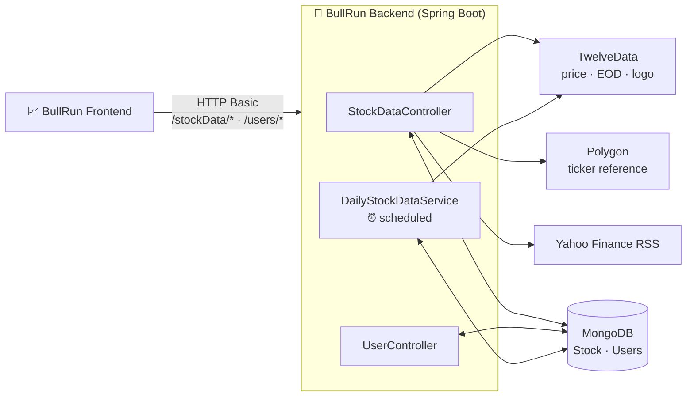
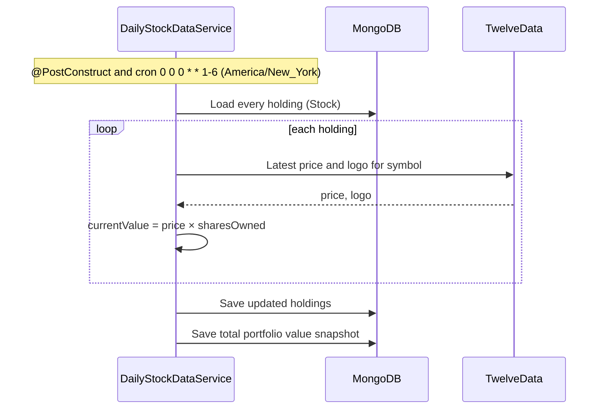

<p align="center">
  
</p>

<p align="center">
  
  
  
  
  
  
</p>

# BullRun Backend

The Spring Boot API behind [BullRun](https://github.com/jlthompson96/BullRun_Frontend), an app for managing a stock portfolio and building financial literacy. It wraps the market data providers behind one API, turns news feeds into JSON, stores the portfolio in MongoDB, and reprices every holding on a schedule.

## What it does

<p align="center">
  
</p>

- **Market data.** Latest price, previous close and company logo from [TwelveData](https://twelvedata.com/), and the company profile from [Polygon](https://polygon.io/).
- **Index prices.** The Dow Jones Industrial Average (`DJI`), S&P 500 (`SPX`) and Nasdaq Composite (`IXIC`) in one call, formatted for display.
- **Stock news.** Pulls a ticker's Yahoo Finance RSS feed and converts the XML to a JSON array of articles.
- **Portfolio.** Add a holding (its price and logo are fetched on the way in), update the shares you own, delete a holding, or check whether a symbol is already in the portfolio.
- **Portfolio history.** A scheduled job reprices every holding and saves a snapshot of the total portfolio value, which `/users/getPortfolioValueOverTime` returns as a time series.
- **Users.** List, look up and create user records.

## How it works



The repricing job runs once at startup and then at midnight, Monday to Saturday, New York time:



## API

All endpoints except `/actuator/**` require HTTP Basic authentication. The user is an in-memory test account defined in [SecurityConfig.java](src/main/java/com/thompson/bullrun/config/SecurityConfig.java); replace it before exposing the API publicly. CORS is open to all origins.

### `/stockData`

| Method | Path | Input | Returns |
| --- | --- | --- | --- |
| `GET` | `/stockData/stockPrice` | `?symbol=AAPL` | TwelveData price |
| `GET` | `/stockData/previousClose` | `?symbol=AAPL` | TwelveData end-of-day quote |
| `GET` | `/stockData/companyLogo` | `?symbol=AAPL` | TwelveData logo URL |
| `GET` | `/stockData/companyProfile` | `?symbol=AAPL` | Polygon ticker details |
| `GET` | `/stockData/indexPrices` | — | `{ "DJI": "…", "SPX": "…", "IXIC": "…" }` |
| `GET` | `/stockData/stockNews` | `?symbol=AAPL` | JSON array of RSS items |
| `GET` | `/stockData/stockExistsInDB` | `?symbol=AAPL` | `true` / `false` |
| `POST` | `/stockData/addStock` | `{ "symbol", "name", "sharesOwned", "costBasis" }` | The saved stock, priced |
| `PUT` | `/stockData/updateSharesOwned` | `{ "symbol", "sharesOwned" }` | Confirmation message |
| `DELETE` | `/stockData/deleteStock` | `{ "stockTicker" }` | Confirmation message |

### `/users`

| Method | Path | Input | Returns |
| --- | --- | --- | --- |
| `GET` | `/users/getUserList` | — | All user records |
| `POST` | `/users/getUser` | User JSON | The matching user |
| `POST` | `/users/createUser` | `{ "firstName", "lastName", … }` | The created user |
| `GET` | `/users/getUserStocks` | — | Every holding in the portfolio |
| `GET` | `/users/getPortfolioValueOverTime` | — | `[{ "date", "totalValue" }, …]` |

There is also a plain `GET /health` check.

### Example

```bash
curl -u <user>:<password> "http://localhost:8080/stockData/stockPrice?symbol=AAPL"

curl -u <user>:<password> -X POST http://localhost:8080/stockData/addStock \
  -H "Content-Type: application/json" \
  -d '{"symbol":"AAPL","name":"Apple Inc.","sharesOwned":10,"costBasis":150.25}'
```

## Configuration

Secrets come from environment variables, referenced in [application.properties](src/main/resources/application.properties):

| Variable | Used for |
| --- | --- |
| `TWELVE_DATA_API_KEY` | Price, previous close, logo and index prices |
| `POLYGON_API_KEY` | Company profile |
| `MONGODB_URI` | MongoDB connection string |
| `MONGODB_DATABASE` | Database name |

The `prod` profile is active by default; `application-local.properties` is available for local overrides.

## Getting started

### Prerequisites

- Java 21
- A MongoDB database
- TwelveData and Polygon API keys

### Run locally

```bash
export TWELVE_DATA_API_KEY=...
export POLYGON_API_KEY=...
export MONGODB_URI=mongodb://localhost:27017
export MONGODB_DATABASE=bullrun

./gradlew bootRun
```

The API listens on http://localhost:8080.

### Run with Docker

The [Dockerfile](Dockerfile) packages the built jar on an ARM-compatible Azul Zulu JDK 21 image:

```bash
./gradlew bootJar
docker build -t bullrun-backend .
docker run -p 8080:8080 \
  -e TWELVE_DATA_API_KEY -e POLYGON_API_KEY -e MONGODB_URI -e MONGODB_DATABASE \
  bullrun-backend
```

## Project structure

```
src/main/java/com/thompson/bullrun/
├── BullRunApplication.java   # Entry point, enables scheduling
├── controller/               # StockDataController, UserController
├── services/                 # StockService, UserService, DailyStockDataService (scheduled repricing)
├── repositories/             # Spring Data MongoDB repositories
├── entities/                 # StockEntity, UserEntity, PortfolioValue
├── config/                   # Security (Basic auth, CORS), Mongo, RestTemplate, API properties
├── common/                   # Health check, REST and Mongo logging
└── exceptions/               # StockDataException
src/main/resources/
├── application*.properties   # Profiles and provider URLs
└── asciiBoot.txt             # The startup banner
```

## License

[MIT](LICENSE) © 2023 Joey Thompson
